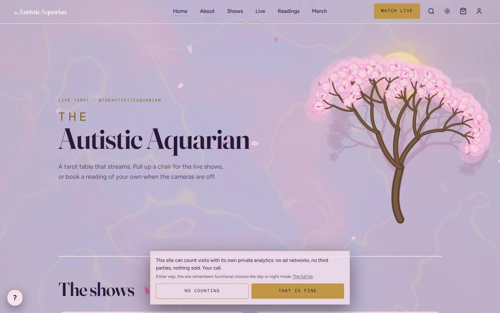
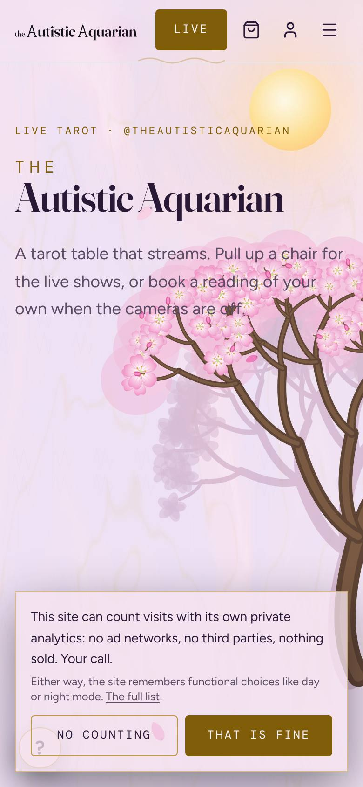

  <picture>
    <source media="(prefers-color-scheme: dark)" srcset="assets/logo-dark.svg" />
    
  </picture>

<h1 align="center"><a href="https://autisticaquarian.com">The Autistic Aquarian</a></h1>

  Live tarot, on air and at the table. The Autistic Aquarian is Vannah's live tarot and streaming brand, and this site is its home: the shows, the schedule, readings and the community in one place. Watch the stream, draw from an interactive tarot table, or book a reading of your own.

<strong>Live site:</strong> <a href="https://autisticaquarian.com">autisticaquarian.com</a>

  <a href="#what-it-is">What it is</a> · <a href="#services">Services</a> · <a href="#features">Features</a> · <a href="#book-or-get-in-touch">Book</a> · <a href="#connected-brands">Connected brands</a>

  
  
  

<table>
  <tr>
    <td align="center" valign="top">
       
      The home page on desktop.
    </td>
    <td align="center" valign="top">
       
      The same page on a phone.
    </td>
  </tr>
</table>

## What it is

The official website for Vannah, the Autistic Aquarian, who reads tarot live on stream and makes other spiritually focused content. The site gathers everything a viewer needs: when the next show is, where to watch it, how to get a reading, and where the community meets. It was designed, built and hosted by Zathena Ventures as part of the studio's client work.

## Services

- **[Readings](https://autisticaquarian.com/readings/)**: book a reading live, recorded, or written

## Features

### The shows

- **Two regular shows**: Tarot Tuesdays with the Autistic Aquarian, and Ask the Autistic Aquarian, both listed on the [shows page](https://autisticaquarian.com/shows/)
- **Watch on the site**: the [live page](https://autisticaquarian.com/live/) carries the stream, with platform tabs and a countdown between shows

### Readings

- **Interactive tarot table**: draw and read from a table right on the site
- **Booked readings**: choose live, recorded or written, whichever suits the question

### The experience

- **A hand-built look**: alcohol-ink marble, cherry blossoms and gilt hairlines, drawn as its own design system
- **Day and night modes**: both designed on purpose rather than one being an inverted copy of the other
- **Accessibility menu**: available on every page, with an [accessibility statement](https://autisticaquarian.com/accessibility/) behind it
- **[Merch](https://autisticaquarian.com/merch/)**: the brand's own merchandise

## Book or get in touch

Book a reading on the [readings page](https://autisticaquarian.com/readings/), or read more [about the Autistic Aquarian](https://autisticaquarian.com/about/).

## Connected brands

- **Built and hosted by [Zathena Ventures](https://zathenaventures.xyz/home)**: the Fort Worth studio behind the site ([public repo](https://github.com/ZATHENA-VENTURES/ZathenaVentures-Public))

## License

© 2026 The Autistic Aquarian. All rights reserved.

## Credits & Contact

Designed, built and hosted by [Zathena Ventures](https://zathenaventures.xyz/home).

Website: [autisticaquarian.com](https://autisticaquarian.com)

> This is the public showcase of a private repository. It presents the project, its features and its live site, and leaves out source code and deployment details.
